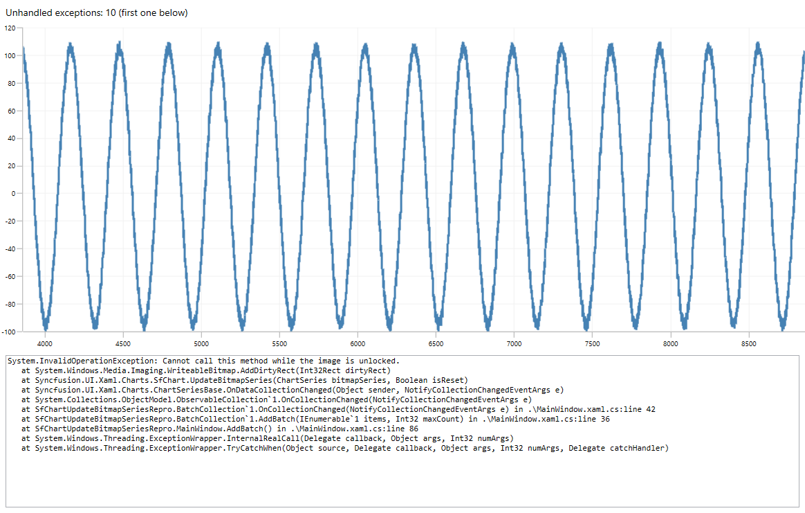

# SfChart.UpdateBitmapSeries: "Cannot call this method while the image is unlocked"

`SfChart.UpdateBitmapSeries` throws an `InvalidOperationException` when the chart's bitmap is replaced while
`WriteableBitmap.Lock()` waits for the render thread. It is the same pattern that was fixed in `SfChart.ClearBuffer`
in 35.1.46.

Syncfusion.SfChart.WPF 35.1.46 (latest on nuget.org), .NET Framework 4.8.

```
System.InvalidOperationException: Cannot call this method while the image is unlocked.
   at System.Windows.Media.Imaging.WriteableBitmap.AddDirtyRect(Int32Rect dirtyRect)
   at Syncfusion.UI.Xaml.Charts.SfChart.UpdateBitmapSeries(ChartSeries bitmapSeries, Boolean isReset)
   at Syncfusion.UI.Xaml.Charts.ChartSeriesBase.OnDataCollectionChanged(Object sender, NotifyCollectionChangedEventArgs e)
   at System.Collections.ObjectModel.ObservableCollection`1.OnCollectionChanged(NotifyCollectionChangedEventArgs e)
   ...
```



## Steps to reproduce

1. Clone the repository and open `SfChartUpdateBitmapSeriesRepro.sln` in Visual Studio.
2. Start the app (F5).
3. Within a few seconds the counter at the top shows unhandled exceptions, and the box at the bottom shows the call
   stack of the first one.

What the sample does:

- A `FastLineBitmapSeries` is bound to an `ObservableCollection` that adds 20 points every 10 ms and raises a
  single `NotifyCollectionChangedAction.Reset` per batch. For bitmap series, `ChartSeriesBase.OnDataCollectionChanged`
  handles `Reset` by calling `SfChart.UpdateBitmapSeries`.
- A background thread resizes the window with `SetWindowPos`. Windows sends the size messages synchronously to the UI
  thread, which processes them while `WriteableBitmap.Lock()` waits for the render thread. In real applications the
  same happens when a host window resizes or a Remote Desktop session reconnects.
- `App.xaml.cs` switches to software rendering so that `Lock()` waits more often and the issue shows within seconds.
  With hardware rendering it also occurs, just less often.

The sample handles the exceptions in `Application.DispatcherUnhandledException` only to keep running and counting;
without that handler the application crashes on the first exception.

## Root cause

`SfChart.UpdateBitmapSeries` reads the `fastRenderSurface` field separately for each call:

```csharp
fastRenderSurface.Lock();
int* pixels = fastRenderSurface.GetPixels();
...
fastRenderSurface.AddDirtyRect(new Int32Rect(0, 0, fastRenderSurface.PixelWidth, fastRenderSurface.PixelHeight));
fastRenderSurface.Unlock();
```

`WriteableBitmap.Lock()` can wait for the render thread and process window messages while it waits. A resize message
runs layout, which calls `SfChart.OnSeriesBoundsChanged` and replaces `fastRenderSurface` with a new bitmap. The
following calls then use the new bitmap, which was never locked:

- `GetPixels()` returns the back buffer of the unlocked new bitmap, and the series pixels are written into it. If the
  new bitmap is smaller than the old one, pixel positions calculated for the old size can be outside the new buffer.
- `AddDirtyRect()` throws the exception above, and the old bitmap stays locked.

## Suggested fix

Read the field once, as `SfChart.ClearBuffer` does since 35.1.46:

```csharp
var surface = fastRenderSurface;
if (surface == null)
    return;

surface.Lock();
try
{
    int* pixels = surface.GetPixels();
    ...
    surface.AddDirtyRect(new Int32Rect(0, 0, surface.PixelWidth, surface.PixelHeight));
}
finally
{
    surface.Unlock();
}
```